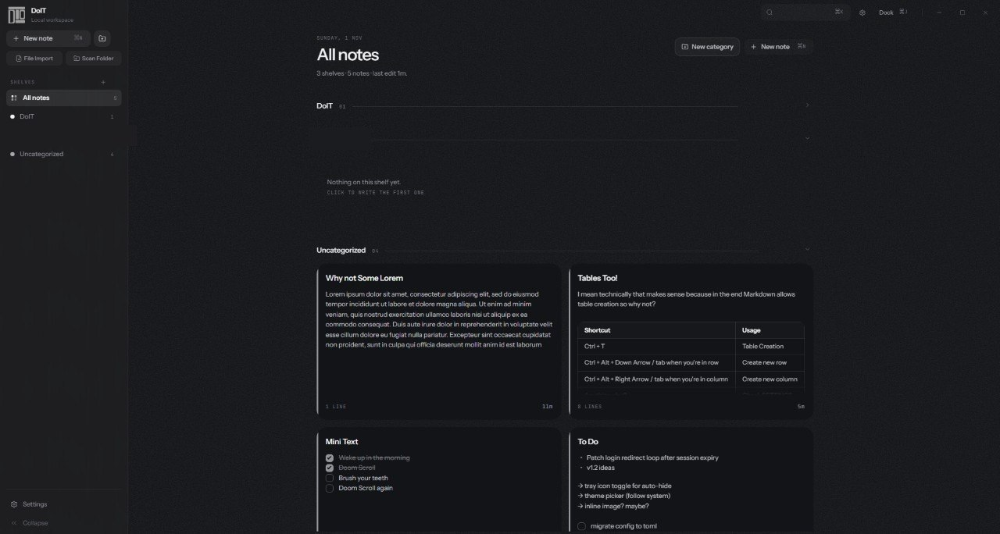
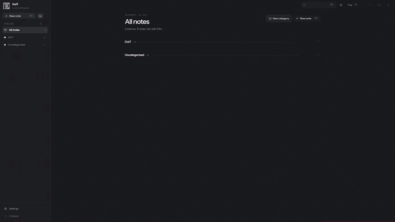
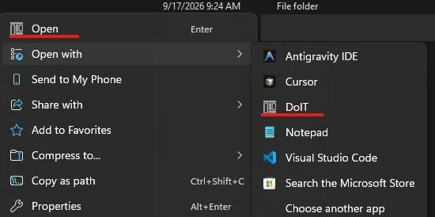

<div align="center">


# DoIT

**Local-first notes and tasks, arranged as an organic bento grid.**

No cloud. No accounts. No tracking. Your notes are plain Markdown files on your own machine.

[](https://github.com/Yasliu/DoIT/releases)
[](LICENSE)
[]()
[](https://v2.tauri.app/)



</div>

---

## Why DoIT

Most note apps want an account before they want your thoughts. DoIT doesn't. Every note is a plain Markdown file in a folder you choose — openable in any editor, portable anywhere, yours forever.

- **Plain files, not a database.** Notes save as standard human-readable `.md` files inside a directory you control. Back them up with anything, sync them with anything, open them with anything.
- **Open external files in place.** Point DoIT at any `.md` or `.txt` and edit it where it lives. Externally opened files save with an explicit Save; DoIT's own notes always autosave.
- **A canvas, not a list.** An asymmetric bento grid that grows each card to match its content density — paragraph, table, checklist, or code.
- **Tray-native.** Folds into the Windows system tray and comes back instantly.
- **Light.** Native Rust via Tauri v2, flat idle footprint under 20 MB RAM.
- **Zero cloud, zero accounts, zero tracking.** No remote auth, no telemetry, MIT-licensed source.

<p align="center">
  
</p>

<p align="center">
  
</p>

### The tray companion

DoIT lives in the system tray as a floating companion — one click expands it into a mini note surface, wherever you are on any monitor.

<p align="center">
  
</p>

## Getting started

1. Download the standalone installer from the [Releases](https://github.com/Yasliu/DoIT/releases) page.
2. Run the setup wizard and pick your install directory.
3. On first launch, set your note repository folder in Settings — every note you create lands there as a Markdown file.

> **Windows SmartScreen notice:** DoIT is an independent open-source build, so SmartScreen may show a blue warning. Click **More info → Run anyway**.

File handling stays sandboxed: imports are capped at 30 MB and path operations are isolated from administrative elevation.

## External files: open, edit, sync

DoIT doubles as your external Markdown editor. Right-click any `.md` or `.txt` in Explorer, choose **Open with → DoIT**, and the file opens in place — it is not copied into your DoIT shelf. Edit in MD mode or text mode, then hit **Save** to write it back to the same file. DoIT's own notes autosave as always.

<p align="center">
  
</p>

Drop any `.md` or `.txt` files into your note repository folder, hit **Sync Repository** in Settings, and they re-index into your grid instantly.

<p align="center">
  
</p>

## What's new in v1.1.6

- Deleting a note now asks for confirmation first, so one stray click can't wipe your work
- The delete dialog no longer spills text past its edges: it wraps and sizes itself cleanly at any window size
- Dock mode now scrolls properly: the mouse wheel and a slim, draggable scrollbar handle long notes, with the formatting bar staying put

The full history lives in the release log below.

<details>
<summary><strong>Release log</strong> (click to expand)</summary>

<details>
<summary><strong>v1.1.6</strong> — November 1, 2026</summary>

- Deleting a note now asks you to confirm first, so nothing disappears by accident
- The delete confirmation dialog wraps its text and resizes to fit, instead of overflowing at small or odd window sizes
- Scrolling works in dock mode again: mouse wheel and a thin, draggable scrollbar handle long notes while the toolbar stays fixed

</details>

<details>
<summary><strong>v1.1.5</strong> — November 1, 2026</summary>

- The tray companion figures out which part of the screen it's docked to before expanding, so the panel always grows toward your open space instead of off the edge
- The expand animation now moves in sync with the window, removing the small jumps and snaps you could catch when the pill turned into a panel

</details>

<details>
<summary><strong>v1.1.4</strong> — November 1, 2026</summary>

- Font pickers in the tray companion and note editor no longer clip past the window edge on short windows
- Sidebar import buttons show their full labels instead of truncating
- The update notification now shows exactly once per version and stays dismissed across restarts

</details>

</details>

## Building from source

**Stack:** Rust + Tauri v2 · TypeScript · Tailwind CSS

**Prerequisites:** C++ build tools, Rust (Cargo), Node.js (npm)

```bash
git clone https://github.com/Yasliu/DoIT.git
cd DoIT
npm install
npm run tauri dev
```

## Feedback

Found a bug or want a feature? [Open an issue](https://github.com/Yasliu/DoIT/issues), mail [yasin@yasliu.com](mailto:yasin@yasliu.com), or DM [@YisoIA](https://x.com/YisoIA).

## License

[MIT](LICENSE)