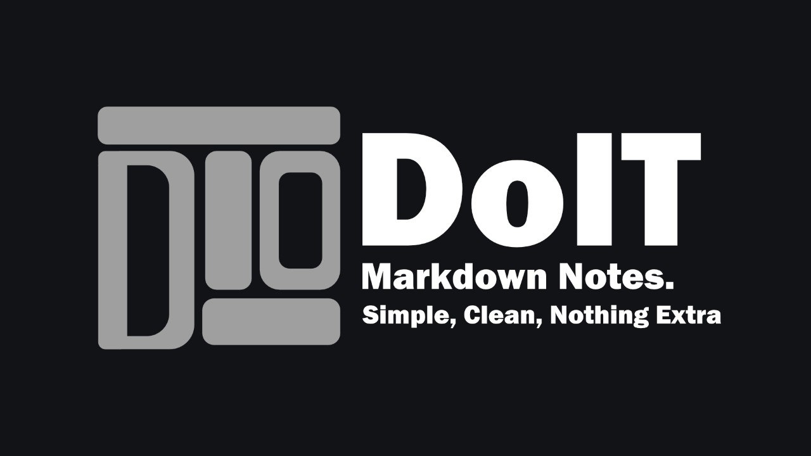
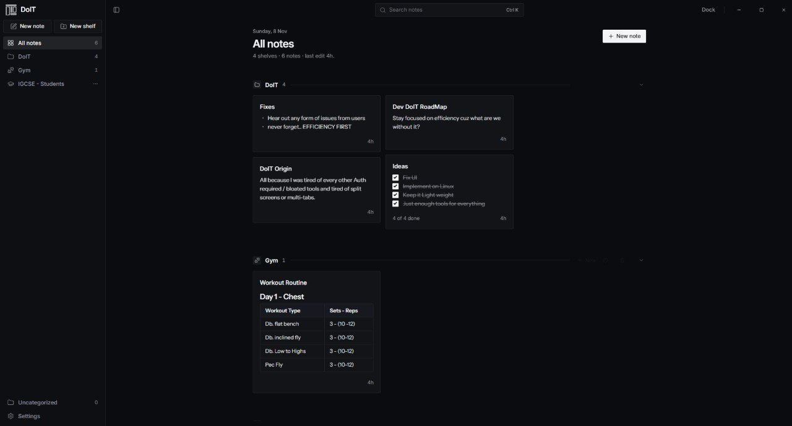
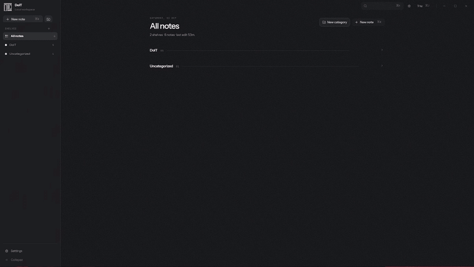
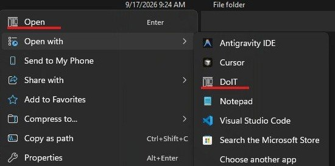

<div align="center">



**Local-first notes and tasks, arranged as an organic bento grid.**

No cloud. No accounts. No tracking. Your notes are plain Markdown files on your own machine.

[](https://github.com/Yasliu/DoIT/releases)
[](https://apps.microsoft.com/detail/9PMXDXXKJDFG?hl=en-us&gl=US&ocid=pdpshare)
[](LICENSE)
[]()
[](https://v2.tauri.app/)



</div>

---

## Why DoIT

Most note apps want an account before they want your thoughts. DoIT doesn't. Every note is a plain Markdown file in a folder you choose — openable in any editor, portable anywhere, yours forever.

- **Plain files, not a database.** Notes save as standard human-readable `.md` files inside a directory you control. Back them up with anything, sync them with anything, open them with anything.
- **Open external files in place.** Point DoIT at any `.md` or `.txt` and edit it where it lives. Externally opened files save with an explicit Save; DoIT's own notes always autosave.
- **A canvas, not a list.** An asymmetric bento grid that grows each card to match its content density — paragraph, table, checklist, or code.
- **Tray-native.** Folds into the Windows system tray and comes back instantly.
- **Light.** Native Rust via Tauri v2. Idles under 20 MB RAM. The built-in web view adds around 180 MB while you're actively editing.
- **Zero cloud, zero accounts, zero tracking.** No remote auth, no telemetry, MIT-licensed source.

<p align="center">
  
</p>

<p align="center">
  
</p>

### The tray companion

DoIT lives in the system tray as a floating companion — one click expands it into a mini note surface, wherever you are on any monitor.

<p align="center">
  
</p>

## Getting started

1. Install from the [Microsoft Store](https://apps.microsoft.com/detail/9PMXDXXKJDFG?hl=en-us&gl=US&ocid=pdpshare), or grab the standalone installer from the [Releases](https://github.com/Yasliu/DoIT/releases) page.
2. Run the setup wizard and pick your install directory.
3. On first launch, set your note repository folder in Settings — every note you create lands there as a Markdown file.

> **Windows SmartScreen notice (standalone installer only):** DoIT is an independent open-source build, so SmartScreen may show a blue warning. Click **More info → Run anyway**. Installing from the Microsoft Store never triggers this.

File handling stays sandboxed: imports are capped at 30 MB and path operations are isolated from administrative elevation.

### On Linux

DoIT for Linux is built and tested on **Fedora with GNOME**. Download it from the [latest release](https://github.com/Yasliu/DoIT/releases/latest):

- **Fedora (recommended):** the `.rpm`, installed with `sudo dnf install ./DoIT-*.x86_64.rpm`. It updates itself like on Windows.
- **Any other distribution (experimental):** the `.AppImage`. Make it executable (`chmod +x DoIT_*.AppImage`) and run it.

Linux uses DoIT's new design: seven themes in light and dark, optional Glass and Boxy looks, and Ctrl+K search. **[The Linux guide](docs/install-linux.md)** covers installing, updating and removing DoIT, where notes are kept, the tray and keyboard shortcut on GNOME, Wayland, and how to report a problem.

## External files: open, edit, sync

DoIT doubles as your external Markdown editor. Right-click any `.md` or `.txt` in Explorer, choose **Open with → DoIT**, and the file opens in place — it is not copied into your DoIT shelf. Edit in MD mode or text mode, then hit **Save** to write it back to the same file. DoIT's own notes autosave as always.

<p align="center">
  
</p>

Drop any `.md` or `.txt` files into your note repository folder, hit **Sync Repository** in Settings, and they re-index into your grid instantly.

<p align="center">
  
</p>

## What's new in v1.2.0

- Official Linux release: native `.rpm` for Fedora with in-app updater, and universal `.AppImage` for other distributions
- Modern UI redesign: 7 customizable themes, Glass transparency mode, Boxy squared geometry, and Spotlight-style search (`Ctrl+K`)
- Dock mode always-on-top retention fix: docking pill reliably stays above other windows across drags, monitor changes, and focus shifts
- Outside-click mutual dismissal between toolbar popups (emoji picker vs. formatting menu)
- Ordered list sequential numbering continuity fix
The full history lives in the release log below.

<details>
<summary><strong>Release log</strong> (click to expand)</summary>

<details>
<summary><strong>v1.2.0</strong> — November 8, 2026</summary>

- Linux packaging and distribution: Fedora RPM with in-app updater and universal AppImage
- Modern UI redesign option with 7 themes, Glass transparency, Boxy geometry, and Spotlight search (Ctrl+K)
- Dock topmost architecture: dock pill reliably maintains topmost z-order across window drags, monitor changes, and workspace focus
- Outside-click mutual dismissal between toolbar popups (emoji picker vs. burger menu)
- Ordered list sequential numbering continuity fix

</details>

<details>
<summary><strong>v1.1.9</strong> — November 7, 2026</summary>

- Uncategorized is now permanently locked to the bottom of the sidebar and dashboard
- Markdown formatting expanded: numbered lists, inline code, web links, footnotes, definition lists, strikethrough, radiant text highlights, subscript and superscript, emoji shortcodes
- Inline image pasting inserts images anywhere in a note while keeping the raw markdown clean and compact
- A smooth slide-in drawer edits image alt text and labels
- Dedicated emoji picker button in the toolbar; click any rendered image to copy it to your clipboard
- Keyboard shortcut settings reorganized into collapsible accordion tiles sorted by category
- Card preview fixes: footnotes and superscripts render cleanly without cut-off text; display scaling fixed so text and images stay sharp at all zoom levels and monitor densities

</details>

<details>
<summary><strong>v1.1.8</strong> — November 6, 2026</summary>

- Card dragging stays with your mouse: moving notes on your board now stays centered right under your cursor, even when grabbing long notes or scrolling down
- Neat tool dropdown: grouped the table, checklist, code block, and image buttons into a clean popup menu so toolbar buttons don't get squeezed or cut off when you narrow the note panel
- Zoom in notes & dock mode: Ctrl + +, Ctrl + - or Ctrl + scroll wheel makes note text bigger or smaller in both the main editor and Dock Mode
- Simplified category menu: removed redundant buttons so you only see one unified "Rename & icon" option
- Blurred glass fixed: the blurred glass theme in Settings now activates and looks crisp as intended
- Bug report button: added a direct "Spotted a bug? Report Here" link in Settings

</details>

<details>
<summary><strong>v1.1.7</strong> — November 5, 2026</summary>

- Notes maximize to 100% of the screen; the flexbox bug that capped them at half width is gone
- Closing a maximized note slides flush off the edge instead of revealing the dashboard mid-animation
- Maximized mode gets a 36px title, taller line height and wider toolbar buttons
- Typing three backticks, with or without a language tag, creates a styled code block; pasted fence pairs convert too
- Shift+Enter or a fresh fence line exits a code block cleanly; a code button sits in the toolbar; inline backticks render monospace
- Typing --- or *** on its own line draws a horizontal rule instantly
- The heading/text style dropdown floats above all layers so nothing ever clips it
- The sidebar track stays stationary while toggling; collapsed + New Note / Import / Scan buttons stack vertically, pixel-centered
- Category counts and hover actions get comfortable padding from the highlight border
- Category icons persist through restarts via native settings storage, with rename and icon editing merged into one searchable dialog
- The bento grid no longer rearranges when the sidebar opens or closes
- Orientation detection fixed for standard horizontal monitors; the tray dock clamps to the taskbar and work area across multi-monitor setups
- Heavy background blurs removed from sliding panels for smooth 60-120 FPS animation
- Dual NSIS/MSI packaging backed by offline WebView2, plus PRIVACY_POLICY.md linked in the README

</details>

<details>
<summary><strong>v1.1.6</strong> — November 1, 2026</summary>

- Deleting a note now asks you to confirm first, so nothing disappears by accident
- The delete confirmation dialog wraps its text and resizes to fit, instead of overflowing at small or odd window sizes
- Scrolling works in dock mode again: mouse wheel and a thin, draggable scrollbar handle long notes while the toolbar stays fixed

</details>

<details>
<summary><strong>v1.1.5</strong> — November 1, 2026</summary>

- The tray companion figures out which part of the screen it's docked to before expanding, so the panel always grows toward your open space instead of off the edge
- The expand animation now moves in sync with the window, removing the small jumps and snaps you could catch when the pill turned into a panel

</details>

<details>
<summary><strong>v1.1.4</strong> — November 1, 2026</summary>

- Font pickers in the tray companion and note editor no longer clip past the window edge on short windows
- Sidebar import buttons show their full labels instead of truncating
- The update notification now shows exactly once per version and stays dismissed across restarts

</details>

</details>

## Building from source

**Stack:** Rust + Tauri v2 · TypeScript · Tailwind CSS

**Prerequisites:** C++ build tools, Rust (Cargo), Node.js (npm)

On Linux you also need the WebKitGTK and GTK development packages (Fedora: `webkit2gtk4.1-devel gtk3-devel libappindicator-gtk3-devel librsvg2-devel`; Debian/Ubuntu: `libwebkit2gtk-4.1-dev libgtk-3-dev libayatana-appindicator3-dev librsvg2-dev`).

```bash
git clone https://github.com/Yasliu/DoIT.git
cd DoIT
npm install
npm run tauri dev
```

## Feedback

Found a bug or want a feature? [Open an issue](https://github.com/Yasliu/DoIT/issues), mail [yasin@yasliu.com](mailto:yasin@yasliu.com), or DM [@YisoIA](https://x.com/YisoIA).

## Privacy policy

Read our plain-language [Privacy Policy](PRIVACY_POLICY.md) (100% local-first, zero tracking, zero data collection).

## License

[MIT](LICENSE)
